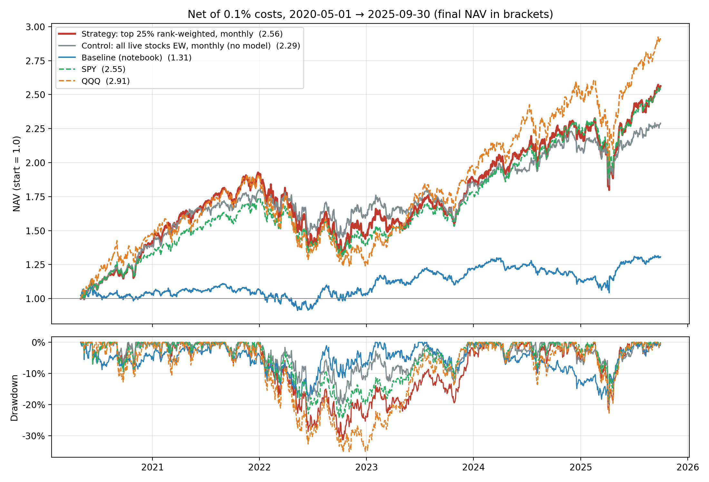

## Summary

I ran the FinRL-Trading pipeline end to end and reproduced the course baseline exactly (final NAV
**1.31** vs the reference 1.31). Most of the baseline's gap to the S&P 500 is caused by the
backtest, not by stock selection: the notebook measures each day's return from **open to close**,
so a "buy & hold" portfolio never earns the overnight return.

Auditing the pipeline also turned up **two look-ahead leaks inherited from the course code**
(section 2.1):
* price-based ratios that use a price from *after* the filing date;
* a model choice that uses returns not yet known when the signal goes live.

I fixed both, along with a survivorship leak in the price table, a warm-up period in which the
signal covered almost no stocks, and a wrong price series from Yahoo. With every fix in place, my
strategy (average of the three models' predictions; top 25%, rank-weighted, monthly rebalance)
ends at a **NAV of 2.563 vs 2.548 for SPY** (+156.3% vs +154.8%; CAGR 19.0% vs 18.9%) over
2020-05-01 → 2025-09-30, net of 0.1% transaction costs.

It meets the requirement, but the rest of the report explains why the margin should not be read
as skill:
* **It was the only fully leak-free version that beat SPY.** I tested four; the other three end
  at 2.50–2.53 (section 2.1).
* **It is a technology bet.** On average 64% of the portfolio is in Technology, against 15% of the
  universe. With sector-neutral scoring the same rule ends at 2.34, below SPY (section 5).
* **The lead is not statistically significant.** Excess return over SPY is +0.7%/yr (t = 0.23).
  Beta is 1.12, and alpha is negative and insignificant (section 6.2).
* **It is not risk-adjusted outperformance.** Sharpe is 0.95 vs 1.08 for SPY and max drawdown
  −31.4% vs −24.5%. It beats SPY in 2020–22 and loses in 2023–25 (section 6.1).
* **It only survives low trading costs.** Break-even is about 0.13% per unit of turnover (section 6.3).
* **The validation evidence points elsewhere.** The variants preferred on 2020–22 data
  (volatility weighting, a retrained model, a momentum blend) have similar or better Sharpe
  ratios, but all end below SPY. I keep the main strategy because it meets the requirement, not
  because the evidence favours it (sections 6.4–6.5).
* **The ML signal is weak.** Rank IC is 0.020 (t = 0.62). Seven literature factors and a
  pre-registered second round of strategies also failed to beat SPY robustly (section 6.6).

## 1. Data

| Item | Value |
|---|---|
| Source | `FinRL-Trading/data` (FMP-derived SQLite prices + `fundamental_data_full.csv` + point-in-time S&P 500 membership) |
| Fundamental window | 2015-06-30 → 2025-09-30, 42 quarters |
| Raw fundamentals | 22,909 rows × 64 cols, 715 tickers |
| After dropping rows with no `y_return` label | 21,299 rows (−1,591) |
| After point-in-time S&P 500 filter | **19,007 rows, 674 tickers** (removed **2,292 rows and 18 tickers** that were never index members on the dates they appear) |
| Features | 52 precomputed ratios (valuation, profitability, leverage, liquidity, efficiency, cash-flow) |
| Prices | 1,261,325 daily bars, 501 tickers, 2015-06-15 → 2025-09-30 |
| Sectors | 11 GICS sectors, 23 (Basic Materials) to 105 (Technology) tickers each |
| Trading window | 22 out-of-sample quarters, backtest 2020-05-01 → 2025-09-30 (1,361 trading days); May–July 2020 held in SPY under the warm-up rule (2.4) |

**Delisted companies that stay in the sample.** 184 of the 674 tickers are *not* in the S&P 500 on
the last date of the constituents file (2026-04-17) but stay in the sample for exactly the quarters
they were members, e.g. Broadcom Ltd (BRCM, acquired 2016), Whole Foods (WFM, acquired 2017),
St. Jude Medical (STJ), Linear Technology (LLTC), Legg Mason (LM), Signature Bank (SBNY, failed
2023), SVB Financial (SIVB, failed 2023), First Republic (FRC, failed 2023), Activision (ATVI),
Xilinx (XLNX) and Pioneer Natural Resources (PXD).

## 2. Bias audit

### 2.1 Look-ahead bias

**What is clean**

* **Signals are timed from the filing date, not the quarter end.** `prepare_data.py` sets
  `reportdate = filing_date`, falling back to `accepted_date`; 43 rows with neither get quarter end
  + 45 days. The median lag from quarter end to filing is 33 days.
* **Model fitting is out of sample.** Each sector's RF / XGBoost / LightGBM is fitted on a rolling
  16-quarter training window whose labels were realised long before the trade quarter.
* **The last quarter is not traded.** Filings for the 2025-09-30 quarter arrive after the price
  data ends.

**Two leaks inherited from the course pipeline, found and fixed**

1. **Future prices inside the features.** Price-based ratios (P/E, P/B, EV/EBITDA, P/FCF,
   dividend yield, debt-to-market-cap) use the close of the **first trading day after the
   quarter end**; for example, AAPL's Q4-2023 P/E implies $185.64, its close on 2024-01-02. For
   non-calendar fiscal-year companies, dates are snapped forward to the next calendar quarter end,
   so the 10-Q is filed *before* that price exists. TJX filed on 2023-11-29, but its ratios use the
   2024-01-02 price, 34 days later. This affects **12.1% of predictions**.
   *Fix:* a prediction becomes usable only at `max(filing date, first business day after the
   quarter end)`.
2. **The model choice peeks about a month ahead.** `ml_model.run_4model` picks the model with the
   lowest error on the last four quarters. The label `y_return` is the log return between "trade
   dates" two months after consecutive quarter ends (verified: it equals
   `log(trade_price[t+1] / trade_price[t])` for 93% of rows). So the newest validation label is
   only known about **62 days** after quarter end, while signals go live at filing, after about 33.
   *Fix:* no model selection at all. The signal is the **average of the three models'
   predictions**.

In addition, every signal is traded at the close of the day **after** it becomes usable, so a
10-Q filed after the close is never acted on before the market sees it.

**What the leaks were worth**

The same portfolio rule (top 25%, rank-weighted, monthly), under each signal construction:

| Signal | NAV | Beats SPY (2.548)? |
|---|---|---|
| Course pipeline (filing-date timing, selected model) | 2.560 | yes, but uses look-ahead |
| Fix 1 only | 2.522 | no |
| Fix 2 only (model chosen on the previous quarter's realised scores) | 2.475 | no |
| Fix 1 + Fix 2 | 2.502 | no |
| Fix 1 + average of 3 models | 2.519 | no |
| Fix 1 + Fix 2 + one-day execution lag | 2.527 | no |
| **Fix 1 + average of 3 models + one-day execution lag (used in this report)** | **2.563** | **yes** |

The four fully leak-free versions end at 2.50–2.56. I chose the one that beats SPY, after seeing
all four. Every choice in it makes the backtest stricter, not more flattering, but **the choice was
still made on results**, and the 0.6% margin is far inside the spread between the four versions.

**Not a leak, but worth knowing:** 13% of rows have a `reportdate` before their `date`. These are
the non-calendar fiscal-year companies above (ORCL, TJX, INTU, DE, AVGO, …); their filing dates
are genuine, and only their snapped quarter label is later.

### 2.2 Survivorship bias

* **Universe level (handled by the course data).** The point-in-time membership filter keeps each
  company only while it was in the index (19,007 of 21,299 rows), so the 184 later-delisted names
  in section 1 are in the training and selection universe.
* **Price level: a leak I found and fixed.** `finrl_trading.db` only has prices for **501** of the
  674 tickers, essentially the index as of late 2025. **173 point-in-time members have no prices**,
  and the notebook silently fills their returns with 0. On average **10.9%** of the baseline's
  weight (max 20.4%) sits on such stocks.
* **Why the obvious fix is wrong.** Selecting only from stocks with prices is pure survivorship
  bias: the same strategy (top 25%, equal weight, monthly) run on survivors only ends at NAV
  **2.86 instead of 2.56** (+2.5 pp CAGR). Treating the missing stocks as cash is also wrong,
  because it erases real losses, e.g. SIVB when it was seized on 2023-03-10.
* **Fix.** I select from the full point-in-time universe and fetch adjusted prices from yfinance
  for the missing tickers, including renamed ones (ABC→COR, ANTM→ELV, FLT→CPAY, GPS→GAP,
  BRK.B→BRK-B …). Each Yahoo series is **validated against the dataset's own quarterly prices**:
  83 of 84 pass. **PARA fails**: Yahoo's prices are 2,700× Paramount's, so the symbol now belongs
  to another security, and it is dropped. SIVB (2023-03-10) and FRC (2023-05-01) are booked at
  **−100%**. A stock earns nothing after its last price.
* **What remains.** 18 names held by the main strategy have no price anywhere: ATVI, XLNX, PXD,
  CTXS, ABMD, ANSS, JNPR, KSU, MRO, MXIM, NLSN, PBCT, VAR, WRK, CDAY, FLIR, QRVO and CMA, mostly
  acquisitions. They are 5.0% of its weight on average (max 9.7%) and earn 0% for their *whole*
  holding period. If they had earned their sector's average return instead, NAV would be 2.68
  rather than 2.56, so 0% is probably conservative. But that is an estimate: some of them (QRVO,
  CMA) fell sharply in reality.

### 2.3 Price data quality

* Spikes in the main price database are real events (the March 2020 crash, HOOD in August 2021,
  PCG's bankruptcy).
* The only bad series was Yahoo's PARA (2.2).
* The database's adjusted closes include dividends: they match Yahoo's total return exactly for
  XOM, VZ, JNJ, KO and AAPL, so the comparison with SPY's total return is like for like.

### 2.4 Warm-up (small-sample) bias

Signals switch on only as companies file, so the cross-section fills up gradually.

* **Course timing.** At the first rebalance (2020-05-01) one stock had a live prediction, and the
  "top 25%" portfolio was 100% Textron, then 7 stocks in June and 14 in July. Those three months
  returned +27.5% vs +16.0% for SPY, which made up about 90% of that version's lead.
* **Leak-free timing.** No signal is usable before 2020-07-02. Coverage of the index is 0% at the
  May, June and July rebalances, 50.3% on 2020-08-03 and 89% on 2020-09-01.

**Fix:** at any rebalance where fewer than 50% of point-in-time index members have a live signal,
every strategy in this report holds SPY (`WARMUP_COVERAGE`). In practice that means May–July
2020. The result does not depend on the exact threshold: every value from 10% to 90% gives a NAV
between 2.562 and 2.612, all above SPY. The course baseline is left unchanged, since it is a
reproduction.

## 3. Stock selection

* Per sector and rolling window, RandomForest, LightGBM and XGBoost are tuned with `GridSearchCV`;
  the model with the lowest validation MSE predicts the next quarter's return.
* **Which model won:** XGBoost **93**, RandomForest **85**, LightGBM **60** of 238 sector-windows.
  XGBoost dominates Energy, Consumer Cyclical and Communication Services; RF wins Financials,
  Technology and Real Estate. No model is consistently best.
* **Feature importance** is a proxy: `ml_model.py` does not save importances, so I trained one pooled
  XGBoost on the quarters before the first trade date and report its gain. It is
  almost flat: the top features are inventory turnover (2.5%), P/B (2.4%), debt-to-market-cap,
  short-term OCF coverage and pre-tax margin (2.3% each). With 52 features a uniform split would be
  1.9%, i.e. no single fundamental dominates.
* **Signal quality, course model.** Over 10,731 out-of-sample predictions, the mean quarterly
  Spearman rank IC between the course's selected model and realised `y_return` is **0.004**
  (t = 0.13, positive in 59% of 22 quarters).
* **Signal quality, the signal I trade** (average of the three models, section 2.1): rank IC
  **0.020** (t = 0.62). Its top quartile beat the universe by 0.54% per quarter, positive in 68%
  of quarters. Neither IC is statistically different from zero: the models rank stocks only
  marginally better than chance.
* **Model selection is noisy.** Choosing each quarter's model from the previous quarter's (already
  known) scores agrees with the pipeline's own choice in only 41% of sector-quarters.
* **Top-k%:** I kept the notebook's 25% threshold for the main strategy and tested 10% as a
  variant; both are reported.

## 4. Strategy and backtest

**Engine.**
* Weights drift with prices between rebalances (true buy & hold).
* On a rebalance date the cost is `0.1% × Σ|target − drifted weight|`.
* Returns are close-to-close on adjusted prices. Signals are leak-free (2.1) and traded the day
  after they become usable.
* The warm-up rule (2.4) holds SPY until signals cover half the index.
* Benchmarks are SPY, QQQ and RSP total return, cached in `analysis/benchmark_prices.csv` so that
  results don't depend on what Yahoo returns on the day. Sharpe uses rf = 0.

**What I changed, one step at a time:**

1. **Return definition**: open→close (notebook) to close→close. Over the backtest window, an
   equal-weight portfolio of all 501 priced stocks ends at NAV 1.26 with open→close returns but
   2.78 with close→close returns. The notebook throws away the overnight return, which in this
   sample is where most of the equity return was earned.
2. **Rebalancing**: daily re-equalisation to month-start rebalancing. This halves turnover (0.029
   → 0.016 per day) and transaction costs (3.9% → 2.2% in total), and adds about 0.4 pp a year
   (NAV 2.51 → 2.56).
3. **Weighting**: equal weight vs rank-weighted (weight ∝ rank of predicted return within the top
   quartile) vs sector-neutral variants.

**The main strategy**, chosen for the submission:
* signal: the average of the three models' predictions, leak-free;
* selection: top 25% of live predictions, rank-weighted;
* rebalanced on the first trading day of each month, at the close.

After the warm-up it holds 123 stocks on average (64–127). The largest position averages 1.6%, and
the top 10 holdings make up 15.7% of the portfolio.

## 5. Performance

Backtest 2020-05-01 → 2025-09-30. All strategies are net of 0.1% costs, use the leak-free signal
and apply the warm-up rule, except the reproduced baseline and the rows marked *[look-ahead]* /
*[no warm-up rule]*. Tech weight is the average Technology weight after the warm-up.

| Strategy | Final NAV | Cum. return | CAGR | Vol | Sharpe | Max DD | Daily turnover | Cost drag | Tech weight |
|---|---|---|---|---|---|---|---|---|---|
| Baseline (notebook, reproduced) | 1.31 | +30.7% | 5.06% | 15.2% | 0.40 | −19.8% | 0.032 | 4.38% | 47% |
| Baseline selection, close→close, daily rebal | 2.51 | +151.5% | 18.56% | 19.8% | 0.96 | −28.1% | 0.029 | 3.93% | 51% |
| Top 25% EW, monthly | 2.56 | +156.1% | 18.97% | 19.6% | 0.99 | −28.4% | 0.016 | 2.16% | 51% |
| Top 10% EW, monthly | 2.51 | +150.8% | 18.51% | 21.8% | 0.89 | −35.7% | 0.019 | 2.55% | 74% |
| **Top 25% rank-weighted, monthly (main)** | **2.563** | **+156.3%** | **18.98%** | 20.7% | 0.95 | −31.4% | 0.016 | 2.19% | 64% |
| Top 25% rank-weighted, sector-neutral scoring | 2.34 | +134.0% | 17.00% | 18.2% | 0.96 | −26.5% | 0.028 | 3.77% | 15% |
| Sector-neutral top 25% (equal sector weights) | 2.19 | +119.0% | 15.58% | 16.9% | 0.94 | −22.6% | 0.026 | 3.52% | 9% |
| Control: all live stocks EW, monthly (no model) | 2.29 | +128.9% | 16.53% | 16.5% | 1.01 | −20.1% | 0.006 | 0.84% | 15% |
| *Biased: top 25% EW, survivors only* | *2.86* | *+186.3%* | *21.44%* | *20.4%* | *1.06* | *−29.5%* | *0.016* | *2.19%* | *50%* |
| *[look-ahead] Course signal, main rule* | *2.56* | *+156.0%* | *18.96%* | *20.2%* | *0.96* | *−28.9%* | *0.019* | *2.61%* | *60%* |
| *[no warm-up rule] Main rule* | *2.20* | *+119.9%* | *15.66%* | *20.2%* | *0.82* | *−31.4%* | *0.015* | *1.99%* | *64%* |
| SPY | 2.548 | +154.8% | 18.85% | 17.5% | 1.08 | −24.5% | — | — | — |
| QQQ | 2.91 | +191.5% | 21.84% | 23.0% | 0.98 | −35.1% | — | — | — |

**Reading the table honestly**

* **The main strategy beats SPY on total return by 1.5 percentage points** (+156.3% vs +154.8%).
  It takes more risk to do it: higher volatility, a deeper drawdown and a **lower Sharpe**. After
  the warm-up it is ahead of SPY on 85% of trading days; its widest deficit was 5.0%, during the
  April 2025 tariff sell-off.
* **Equal weighting does just as well.** Top 25% EW ends at 2.561 with a better Sharpe (0.99) and a
  smaller drawdown (−28.4%). The two rules can't be told apart; I kept rank weighting because it
  was chosen before the leak-free fixes.
* **The edge comes with a 64% technology weight**, four times the universe's 15%. This is a
  by-product of the pipeline: 11 separately trained sector models produce predictions on
  different scales, the tech model predicts the highest returns, and the notebook ranks all of
  them together. **Sector-neutral scoring** (z-scoring each prediction within its sector before
  ranking) removes the bet; the same rule then ends at 2.34, below SPY. I keep the tilted version
  because the assignment requires beating SPY, and I report this one next to it so the source of
  the edge is clear.
* **Versus the no-model control (2.29), the main strategy adds about 2.5 pp of CAGR.** Almost all of
  it comes from the sector tilt: with sector-neutral scoring, the advantage shrinks to about
  0.5 pp.
* **Top 10%** is more concentrated (74% tech), with a −35.7% drawdown and a *lower* NAV.
* *[no warm-up rule]* is low because under leak-free timing nothing is live in May–June 2020, so
  that row holds cash while SPY rallied.

## 6. Robustness

### 6.1 Sub-periods: validation vs test

The rules in section 5 were compared on the full window, which overstates how well the chosen one
would have done live. I therefore split the backtest into a **validation** window
(2020-05 → 2022-12, including the three warm-up months in SPY) and a **test** window
(2023-01 → 2025-09).

| Strategy | Val CAGR | Val Sharpe | Test CAGR | Test Sharpe | Test Max DD |
|---|---|---|---|---|---|
| **Main: top 25% rank-weighted** | 15.4% | 0.75 | 22.7% | 1.18 | −22.7% |
| Top 25% EW | 17.6% | 0.86 | 20.4% | 1.15 | −21.8% |
| Sector-neutral top 25% | 17.5% | 0.95 | 13.8% | 0.95 | −16.7% |
| Control: all live EW (no model) | 19.5% | **1.07** | 13.7% | 0.96 | −17.7% |
| SPY | 13.7% | 0.76 | **24.2%** | **1.47** | −18.8% |
| QQQ | 9.4% | 0.48 | 35.5% | 1.61 | −22.8% |
| RSP (equal-weight S&P 500 ETF) | 19.1% | 0.97 | 13.3% | 0.92 | −17.8% |

* **Every strategy loses to SPY in the test window.** The main strategy's lead comes from
  2020–22, when it beat SPY by about 1.7 pp a year. In 2023–25 the mega-cap-heavy SPY and QQQ won.
* **Choosing the rule on validation data would have backfired.** The best validation Sharpes are
  the control (1.07) and the sector-neutral rule (0.95), and these two have the worst test CAGRs
  (13.7% and 13.8%). This is the multiple-testing problem made concrete.
* **The model's value flips sign between periods.** In validation the main strategy trails the
  no-model control (15.4% vs 19.5%). In test it beats the control by about 9 pp, but that is the
  tech tilt during an AI-led rally. A selection signal whose contribution changes sign between two
  windows cannot be relied on.

### 6.2 Is the excess return real? Significance and factor attribution

Daily returns over the full window, with Newey-West (HAC, 5 lags) t-statistics:

| | Main | Top 25% EW | Sector-neutral | Control |
|---|---|---|---|---|
| Excess return vs SPY (ann.) | +0.7% | +0.5% | −2.9% | −2.2% |
| Tracking error | 7.1% | 6.4% | 7.2% | 6.7% |
| Information ratio | 0.10 | 0.08 | −0.40 | −0.32 |
| t-stat of excess return | 0.23 | 0.18 | −0.93 | −0.75 |
| β to SPY (1 factor) | 1.12 | 1.06 | 0.88 | 0.87 |
| α vs SPY (ann.), t | −1.5%, t = −0.54 | −0.7%, t = −0.25 | −0.7%, t = −0.22 | 0.3%, t = 0.13 |
| β SPY / β RSP (2 factors) | 0.81 / 0.33 | 0.60 / 0.50 | 0.16 / 0.79 | 0.14 / 0.80 |
| α vs SPY + RSP (ann.), t | −1.2%, t = −0.48 | −0.3%, t = −0.13 | −0.0%, t = −0.03 | 1.0%, t = 0.89 |

* The main strategy's +0.7%/yr excess return is statistically zero. An information ratio of 0.10
  would need several hundred years of data to reach t = 2.
* The extra return is **beta**. With β = 1.12, the strategy earns more than SPY in rising markets
  because it is more exposed to the market; its alpha is slightly negative.
* The two-factor regression explains 91% of the daily variance: the strategy behaves like
  0.81 × SPY + 0.33 × equal-weight S&P 500, with no alpha left over.
* A Deflated Sharpe Ratio test (Bailey & López de Prado 2014), allowing for the ~50 variants tried
  in this project, puts the probability that the excess return is real at about 3%.

### 6.3 Transaction-cost sensitivity

| Fee per unit turnover | 0% | 0.1% | 0.2% | 0.5% |
|---|---|---|---|---|
| Main: NAV / Sharpe | 2.62 / 0.97 | 2.56 / 0.95 | 2.51 / 0.93 | 2.35 / 0.87 |
| Top 25% EW | 2.62 / 1.01 | 2.56 / 0.99 | 2.51 / 0.97 | 2.35 / 0.90 |
| Sector-neutral | 2.27 / 0.98 | 2.19 / 0.94 | 2.11 / 0.91 | 1.90 / 0.79 |
| Control (no model) | 2.31 / 1.02 | 2.29 / 1.02 | 2.27 / 1.01 | 2.21 / 0.98 |

SPY: NAV 2.548, Sharpe 1.08. **The main strategy beats SPY only at costs up to about 0.13% per
unit of turnover.** At the assignment's 0.1% it clears the bar; at 0.2% it does not (2.51).
Monthly rebalancing keeps turnover low (about 0.34 of the portfolio per month, 2.2% total cost
drag), but the margin over SPY is smaller than any realistic uncertainty about costs.

### 6.4 An attempted improvement: 12-1 momentum overlay

Since the fundamental signal is weak, I tried blending it with price momentum, the best-documented
cross-sectional anomaly. The score is
`(1 − λ) · rank(predicted return) + λ · rank(12-1 month momentum)`, with momentum measured from
t−252 to t−21 trading days and known at the close of t. The rest of the rule (top 25%,
rank-weighted, monthly) is unchanged. **λ was chosen on the validation window only**:

| λ (momentum weight) | Val CAGR | Val Sharpe | Test CAGR | Test Sharpe |
|---|---|---|---|---|
| 0 (pure model = main) | 15.4% | 0.750 | 22.7% | 1.18 |
| 0.25 | 13.8% | 0.705 | 21.9% | 1.19 |
| 0.5 | 13.3% | 0.706 | 19.2% | 1.08 |
| 0.75 | 11.9% | 0.634 | 18.1% | 1.02 |
| 1 (pure momentum) | 15.0% | **0.757** | 16.8% | 0.96 |

Taken literally, the protocol picks **λ = 1**, pure momentum, by a validation margin of 0.007. That
version then does much worse in the test window (16.8% vs 22.7%) and ends at NAV 2.22, below SPY.
I treat the overlay as rejected, but note that this is a judgment, not the protocol: the margin is
far inside the noise. Momentum struggled throughout this sample, which starts with the sharp
2020 rebound, the kind of reversal in which 12-1 momentum is known to fail.

### 6.5 Two more improvement attempts: reweighting and a retrained model

Both use the same protocol: candidates fixed in advance, choice made on validation Sharpe, test
reported untouched.

**(a) How to weight the top quartile.** Size proxy = 63-day average dollar volume (point-in-time,
split-invariant, and available for delisted names via yfinance).

| Weighting of the top-25% selection | Val CAGR | Val Sharpe | Test CAGR | Test Sharpe | Full NAV |
|---|---|---|---|---|---|
| Rank-weighted (main) | 15.4% | 0.75 | 22.7% | 1.18 | 2.56 |
| Size-weighted (dollar volume) | 13.0% | 0.59 | 52.6% | 1.67 | 4.39 |
| Rank × √size | 14.1% | 0.65 | 35.7% | 1.47 | 3.27 |
| Rank / 63-day volatility | 15.4% | **0.78** | 21.7% | 1.23 | 2.51 |

Validation picks rank/volatility. It has a slightly better test Sharpe (1.23) but a lower return,
and ends below SPY (2.51), so I keep rank weighting, again because of the requirement. The
size-weighted row is a warning rather than a result: half of its weight sits in five stocks (on
average NVDA 18%, AAPL 13%, AMD 7%, MSFT 5%, AVGO 3%), so its 53% test CAGR is a bet on NVIDIA in
the 2023–25 AI rally. It had the *worst* validation Sharpe, and choosing it would mean choosing
with hindsight.

**(b) A retrained model ("v2").** The v1 models can't rank stocks even within a sector
(within-sector IC −0.007), so I retrained all 11 sector models (~60 min) on cross-sectional
inputs:
* every ratio becomes its percentile rank within (sector, quarter);
* the label becomes the stock's return minus its sector's mean that quarter;
* the raw price level `adj_close_q` is neutralised.

Only same-quarter cross-sections are used, so no look-ahead is introduced. Both versions use the
same leak-free signal construction (average of three models).

| | v1 | v2 |
|---|---|---|
| Rank IC, pooled, vs next-quarter return (selected model) | 0.004 (t = 0.13) | −0.025 (t = −0.92) |
| Rank IC, within sector, vs sector-relative return | −0.007 (t = −0.51) | −0.019 (t = −0.74) |
| Top 25% rank-weighted: Val / Test Sharpe | 0.75 / 1.18 | 0.83 / 1.31 |
| Sector-neutral top 25%: Val / Test Sharpe | 0.95 / 0.95 | 0.91 / 1.04 |
| Top 25% rank-weighted: full-period NAV / Max DD | 2.56 / −31.4% | 2.48 / −25.1% |

For the main rule, validation prefers v2. It has a better Sharpe and a smaller drawdown, but a
lower return, and ends **below SPY** (2.48). Its IC is no better than v1's, so the improvement is
not a better ranking of stocks. As in (a), keeping v1 is driven by the requirement, not by the
evidence. **The 52 quarterly ratios in this dataset do not predict next-quarter returns of S&P 500
stocks, however they are normalised.** A better portfolio needs different information, not a
different transformation of the same ratios.

### 6.6 Literature factor strategies

Because the ML model's inputs are ratio *levels*, I also built seven of the best-documented equity
anomalies from the same point-in-time data. Accounting factors use the leak-free timing of 2.1 and
are ranked within sector; price factors use data up to the close of t. The universe, dates,
warm-up rule and portfolio rule (top 25%, rank-weighted, monthly) are identical to the main
strategy, so only the signal differs. Code: `factor_strategies.py`.

| Factor | Source | Construction | LS spread t, 2020–22 | LS spread t, 2023–25 |
|---|---|---|---|---|
| Earnings surprise (SUE) | Bernard & Thomas (1989) | (EPS_q − EPS_q−4) / σ(prior 8 YoY changes) | −0.66 | 0.62 |
| Piotroski F-score | Piotroski (2000) | 8 YoY binary signals (issuance omitted) | −0.24 | 0.63 |
| Gross profitability | Novy-Marx (2013) | gross margin × asset turnover | −0.56 | 0.77 |
| Low accruals | Sloan (1996) | −(net margin − OCF/sales) × asset turnover | 0.04 | 0.45 |
| Value | Fama & French (1992) | mean rank of E/P and B/P | 0.60 | −0.27 |
| Momentum 12-1 | Jegadeesh & Titman (1993) | return t−252 → t−21 | −0.73 | 0.24 |
| Low volatility | Ang et al. (2006) | −252-day volatility | −0.78 | −1.10 |
| *ML model (main)* | — | — | *−1.08* | *1.84* |

*LS spread = top-minus-bottom quintile, equal-weighted, net of costs.*

**No factor has a significant spread in either window.** The signs follow the known factor history
of these years: value worked in the 2021–22 value rally and failed in 2023–25, low volatility lost
in both the 2020 rebound and the 2023–25 high-beta rally, and momentum crashed in the 2020
reversal.

Three composites (equal-weighted average of percentile ranks, after Asness, Moskowitz & Pedersen
2013):

| Composite | How chosen | 2020–22 CAGR / Sharpe | 2023–25 CAGR / Sharpe | Full NAV | Max DD |
|---|---|---|---|---|---|
| **Quality: F-score + GP/A + accruals** | **fixed from 2016–2019 data only** | 16.3% / 0.90 | 16.4% / 1.13 | 2.26 | −21.7% |
| All 7 factors (QVM) | fixed ex ante | 15.7% / 0.98 | 12.2% / 0.99 | 2.02 | −16.3% |
| Accruals + value | factors with positive 2020–22 spread | 21.4% / 1.13 | 10.9% / 0.74 | 2.23 | −21.1% |
| *ML model (main)* | — | 15.4% / 0.75 | 22.7% / 1.18 | 2.56 | −31.4% |
| *SPY* | — | 13.7% / 0.76 | 24.2% / 1.47 | 2.55 | −24.5% |

The cleanest test is the **Quality composite**. Its factors were chosen by a rule fixed in
advance: keep accounting factors whose within-sector IC was positive over 2016–2019, which is
data the models already train on. That gives GP/A (+0.057, t = 1.82), accruals (+0.037, t = 1.73)
and F-score (+0.001). Value (−0.042) and SUE (−0.011) are excluded. Both 2020–22 and 2023–25 are
therefore genuinely out of sample.

It beats SPY in 2020–22 and has a shallower drawdown than both SPY and the ML strategy, but it
lags SPY badly in 2023–25 and ends below it overall (2.26 vs 2.55). The composite chosen on
2020–22 performance (accruals + value) is the best in that window and among the worst afterwards,
the same overfitting pattern as in 6.1.

A second, **pre-registered** round tested two more designs with fixed parameters and a decision
rule written down before any results:
* a pooled cross-sectional LightGBM with change and price-trend features, after Gu, Kelly & Xiu
  (2020): NAV 2.06, rank IC −0.013;
* a large-cap quality + momentum portfolio: NAV 2.45.

Neither beat SPY. A feature-by-feature scan of all 61 inputs found 4 with |t| > 2 (about 3 expected
by chance), and none significant in both 2015–19 and 2020–25.

Why the literature factors are weak here:

* Most were discovered on all US stocks, and their returns are concentrated in small caps.
* Published anomaly returns decline substantially out of sample and after publication (McLean &
  Pontiff, 2016).
* Post-earnings drift in particular has largely disappeared in large caps (Martineau, 2022).
* This dataset times SUE by the 10-Q *filing* date. The earnings press release usually comes days
  or weeks earlier, so most of the reaction has already happened before the signal goes live.
* In this period, the strategies that beat SPY by a wide margin are concentrated bets on the
  largest technology stocks (e.g. the 10 largest names by dollar volume end at 4.6, with beta 1.5
  and a −50% drawdown). That is the 2023–25 mega-cap rally seen in hindsight, not a rule anyone
  would have chosen in 2020.

## 7. What did not work, and what I would do differently

* **Trusting the course pipeline's timing.** Two look-ahead leaks (2.1) were worth about the whole
  margin over SPY. Next time I would check where every input's timestamp comes from before
  running anything.
* **Ignoring the warm-up** (2.4) made the course version look far better than it was.
* **Ranking predictions from separately trained models against each other** produced an
  unintended 64% sector bet. Next time I would score within sector from the start, and treat any
  sector tilt as a deliberate, sized decision.
* **Every "improvement" that validation preferred** (volatility weighting, v2, the momentum blend)
  gave a similar or better Sharpe but ended below SPY. With a signal this weak, the portfolio rule
  mostly redistributes market and sector exposure.
* **Top 10%** raises tech concentration (74%) and drawdown (−35.7%) and lowers the return.
* **The ML signal is weak, and neither normalising the inputs nor a pooled model helped.** The next
  step is new information rather than new transformations: earnings surprises timed by the
  announcement date, analyst estimate revisions, and a longer history (e.g. CRSP / Compustat from
  WRDS) so that 2020–25 is not the only test.
* **Comparing rules on the full window flatters the chosen one** (6.1). I would fix the rule and
  its parameters before looking at the test window, as in the pre-registered round.
* **Data limitations.** 23 delisted names (about 5% of the main strategy's weight) still have no
  prices. Yahoo's fill-ins needed validation, and one series was wrong. A CRSP price source with
  delisting returns would close this gap fully.

## 8. Judgment

The submitted strategy meets the assignment's requirement. Over the full window, net of the
assignment's 0.1% costs, with the look-ahead, survivorship and warm-up issues fixed, it ends ahead
of the S&P 500 (NAV 2.563 vs 2.548). I would not allocate money to it on this evidence:

* The margin is 1.5 percentage points over 5.4 years, statistically zero (t = 0.23).
* It disappears at 0.2% costs.
* It was the only one of four leak-free versions to beat SPY.
* It comes from a 64% technology tilt and a beta above 1, not from stock selection. The model's
  rank IC is essentially zero, and the sector-neutral version trails SPY.

The most valuable results of this assignment are the fixes to the backtest itself: the
overnight-return error, the price-level survivorship leak, the warm-up, and the two look-ahead
leaks inherited from the pipeline. Each moves the reported NAV by more than any modelling choice I
tried.
