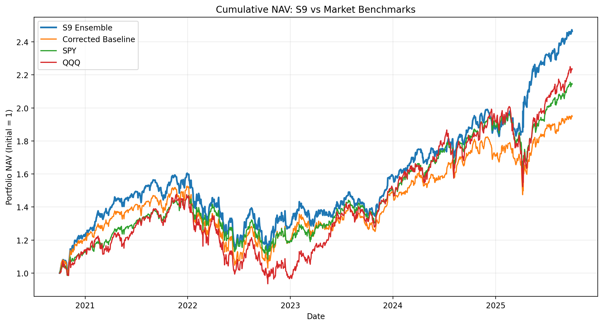
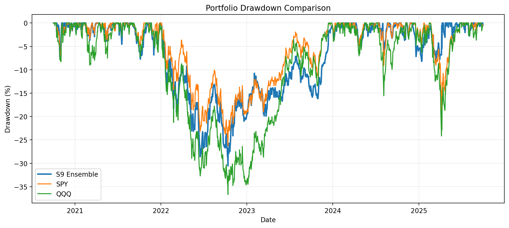

# Improving Fundamental Stock Selection with a Model Ensemble

**Columbia University · STAT GR5398 · Assignment 1 (Fall 2026)**  
**Quanjing He (qh2305)**

[Research report (PDF)](Report.pdf) · [Medium article](https://medium.com/@qh2305/can-a-simple-model-ensemble-beat-the-s-p-500-77d5ea40f703)

## Overview

This project extends the fundamental stock selection baseline in [FinRL-Trading](https://github.com/AI4Finance-Foundation/FinRL-Trading). The baseline trains Random Forest, XGBoost, and LightGBM models by sector and selects the model with the lowest validation MSE. I reproduced that workflow, checked its data and backtest assumptions, and tested nine changes to stock selection, weighting, rebalancing, and model combination.

The final strategy (**S9**) averages predictions from all three models, selects the top 25% of eligible stocks across sectors, and targets equal weights at weekly rebalances. Holdings can drift between rebalances, and stocks that become ineligible are removed. The backtest uses adjusted open-to-next-open returns and charges **0.1% of absolute turnover**.

## Results

The comparable backtest runs from **October 2, 2020, to September 30, 2025**, with initial NAV set to 1. Performance below is based on the saved net S9 and corrected-baseline backtests; SPY and QQQ are adjusted-price buy-and-hold benchmarks.

| Portfolio | Final NAV | CAGR | Annual volatility | Sharpe | Max drawdown |
| --- | ---: | ---: | ---: | ---: | ---: |
| **S9 Ensemble** | **2.4642** | **19.79%** | 18.94% | **1.053** | -30.56% |
| Corrected Baseline | 1.9482 | 14.29% | 19.61% | 0.782 | -32.54% |
| SPY | 2.1438 | 16.50% | 17.48% | 0.965 | -26.29% |
| QQQ | 2.2353 | 17.48% | 22.97% | 0.819 | -36.69% |

Sharpe ratios assume a zero risk-free rate. S9 and the corrected baseline include modeled transaction costs; ETF benchmarks do not use the same rebalancing cost model. The original reproduced baseline (NAV 1.3179) uses a different intraday-return convention and is not a like-for-like comparison with S9.



*Figure 1. Cumulative NAV of S9, the corrected baseline, SPY, and QQQ.*



*Figure 2. Drawdowns of S9, SPY, and QQQ.*

The complete S1–S9 development/validation comparison is in [`strategy_summary_dev_val.csv`](results/strategy/strategy_summary_dev_val.csv). S9 did not beat SPY in 2024 validation (18.38% versus 26.64% CAGR); in the January–September 2025 test period, S9 returned 30.87% cumulatively versus 13.46% for SPY.

## Files

| File | Description |
| --- | --- |
| [`FinRL_Trading_Assignment1.ipynb`](FinRL_Trading_Assignment1.ipynb) | Baseline reproduction, bias checks, S1–S9 experiments, final evaluation, and feature importance |
| [`prepare_data.py`](prepare_data.py) | Converts the public source data into the prepared fundamental and daily price files |
| `fundamental_run_model.py`, `ml_model.py` | Original sector-model training workflow |
| [`Report.pdf`](Report.pdf) | Short research report |
| [`results/strategy/strategy_summary_dev_val.csv`](results/strategy/strategy_summary_dev_val.csv) | Development and validation comparisons for S1–S9 and benchmarks |
| [`results/strategy/ensemble_models/final_evaluation.csv`](results/strategy/ensemble_models/final_evaluation.csv) | Full-period and 2025 test performance |
| [`results/strategy/ensemble_models/s9_backtest_full.csv`](results/strategy/ensemble_models/s9_backtest_full.csv) | Daily S9 portfolio returns and NAV |
| [`results/strategy/ensemble_models/feature_importance/`](results/strategy/ensemble_models/feature_importance/) | Sector 45 permutation-importance plot and values |
| [`results/strategy/ensemble_models/final_audit/`](results/strategy/ensemble_models/final_audit/) | NAV/drawdown plots, period metrics, and filing-date sensitivity results |

Raw data, prepared data, sector predictions, and large intermediate holdings are not committed. The notebook generates them during execution.

## Reproduction

Run the following commands **from this submission directory**, where `prepare_data.py` and the notebook are located.

### 1. Install dependencies

Use a Python 3 environment with Jupyter Notebook or Google Colab. Install the listed packages:

```bash
python -m pip install -r requirements.txt
```

The requirements specify `pandas<3`; exact versions of other packages are not pinned. Some results may vary slightly with package versions or refreshed benchmark data.

### 2. Download and prepare the data

Download these files from the public [FinRL-Trading data directory](https://github.com/AI4Finance-Foundation/FinRL-Trading/tree/master/data):

- `finrl_trading.7z` (extract `finrl_trading.db`)
- `fundamental_data_full.csv`
- `sp500_historical_constituents.csv`

Place them in a local `data/` folder:

```text
data/
├── finrl_trading.db
├── fundamental_data_full.csv
└── sp500_historical_constituents.csv
```

Extract `finrl_trading.7z` with 7-Zip or another compatible tool. Then run:

```bash
python prepare_data.py --db data/finrl_trading.db --fundamentals data/fundamental_data_full.csv --constituents data/sp500_historical_constituents.csv --output-dir prepared --start 2015-01-01 --end 2025-09-30 --trade-start 2020-09-30
```

This should produce `prepared/final_ratios.csv`, `prepared/daily.csv`, and 11 sector files (`prepared/sector10.xlsx` through `sector60.xlsx`). The reference prepared fundamental sample contains **19,007 rows, 674 tickers, and 42 quarters**.

### 3. Run the notebook

Open [`FinRL_Trading_Assignment1.ipynb`](FinRL_Trading_Assignment1.ipynb) in Jupyter or Colab and run its cells **in order**. When running locally, start Jupyter from the submission directory. Alternatively, set `GR5398_PROJECT_DIR` to the absolute path of this directory before executing the notebook. For Colab, mount Google Drive and set that environment variable to the project folder under `/content/drive/MyDrive/` if the folder cannot be detected automatically. The first cell installs `requirements.txt` and locates the project files.

The notebook will:

1. Reproduce the original sector-based baseline and examine its prediction quality.
2. Rebuild point-in-time feature/label availability, recover verified ticker aliases, and construct the corrected backtest.
3. Train and evaluate S1–S9 on development (2020–2023) and validation (2024) data.
4. Extend the selected S9 strategy through September 2025, run the final evaluation and sensitivity checks, and save figures and tables under `results/`.

Model training across all sectors can take substantial time. Completed intermediate files are reused by several training cells when present. An internet connection is needed for the SPY/QQQ downloads through `yfinance`. The saved output files are included for inspection; an independent end-to-end rerun from a clean clone has not been performed.

## Data checks and limitations

The prepared sample uses historical S&P 500 membership: **2,292 of 21,299** eligible fundamental rows were removed by that filter. Financial signals are delayed until their assigned quarter end and recorded reporting dates; training labels must be realized before the model's decision date.

Some limitations remain. The source price history lacks **93 tickers**, affecting **868 candidate signals**, and some filing timestamps are missing or inconsistent. Removing the 30 flagged signals from portfolio selection changes S9's full-period NAV from **2.4642 to 2.4556**, but this check does not retrain the models. The 2024 validation period was consulted repeatedly during development, and the 2025 baseline results were previously observed. See the [research report](Report.pdf) for details.

## References

- [STAT GR5398 FinRL-Trading Assignment 1](https://github.com/AI4Finance-Foundation/STAT-GR5398-Columbia-University/tree/master/Fall-2026/Assignment1/FinRL-Trading)
- [FinRL-Trading source and public datasets](https://github.com/AI4Finance-Foundation/FinRL-Trading)
- [Medium blog: Can a Simple Model Ensemble Beat the S&P 500?](https://medium.com/@qh2305/can-a-simple-model-ensemble-beat-the-s-p-500-77d5ea40f703)
